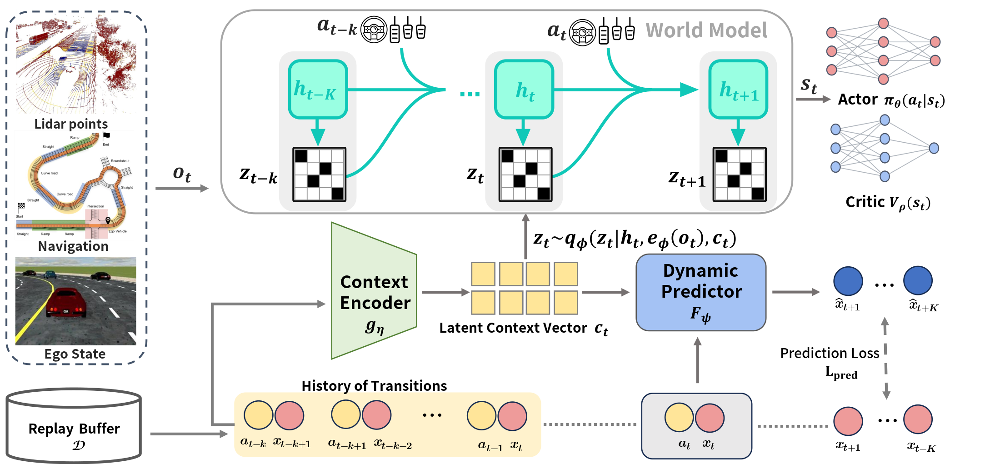
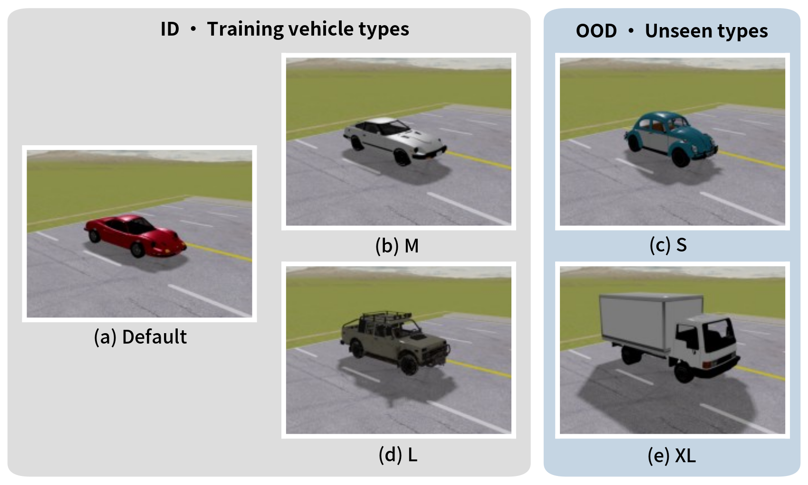
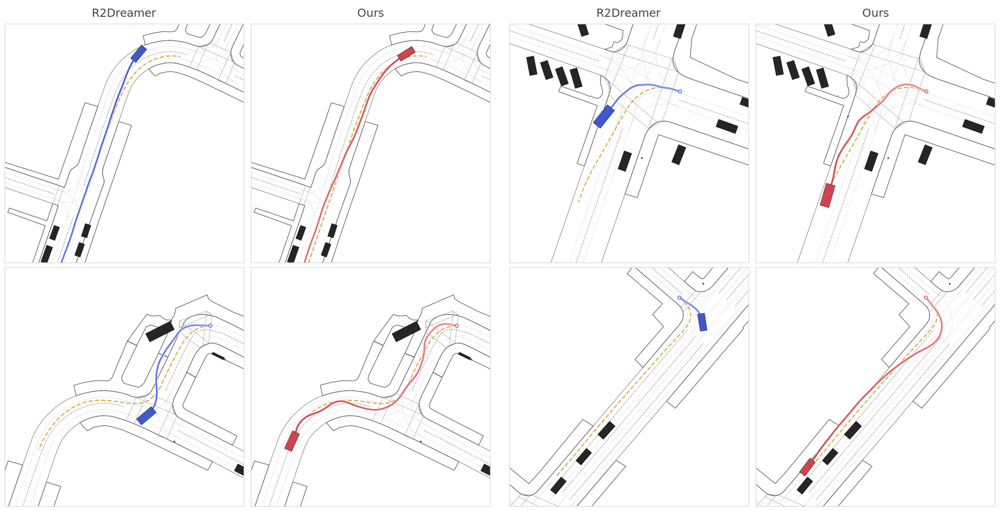

<div align="center">

# RHC-Drive

### Response-History-Conditioned World Models for Zero-Shot Cross-Chassis Driving

Learn vehicle dynamics from recent action–response history and condition a world model for driving across unseen chassis.

[Method](#method) · [Installation](#installation) · [Training](#training) · [Evaluation](#evaluation) · [Deployment guide](docs/cloud_roundabout_training.md) · [Documentation](docs/README.md)

</div>



Research implementation for the RHC-Drive manuscript. This repository includes the history context encoder, auxiliary dynamics supervision, posterior-conditioned world model, MetaDrive environments, and reproducible training and evaluation workflows. Paper links, citation metadata, and downloadable checkpoints will be added with the paper release.

## Method

RHC-Drive infers a compact dynamics context from completed transitions instead of requiring vehicle parameters at deployment. The policy runs with fixed network weights while its context updates online.

1. **Response history.** At 10 Hz, collect the last five completed action–response tokens. Each token contains longitudinal acceleration, yaw rate, speed, measured front-wheel angle, and the preceding throttle/brake and steering commands. A validity mask handles episode starts.
2. **Context learning.** A two-block Transformer and masked pooling produce an eight-dimensional context. A residual response predictor supplies five-step prediction supervision, together with cross-episode context exchange between samples with the same vehicle configuration.
3. **World-model conditioning.** Inject the context into the RSSM posterior through a shallow conditioning path. In the full method, world-model gradients are stopped at the context encoder. The actor and critic use the resulting latent state.

The overview is from our manuscript; editable [SVG figures](assets/figures/) are included alongside the README previews.

## Driving benchmarks

The code supports procedural **T-intersection** and **roundabout** tasks, plus **nuPlan-derived scenarios** converted for MetaDrive.



Training uses Default, M, and L chassis with randomized mass and wheel friction. Evaluation separates held-out maps with the training chassis distribution (**ID**) from unseen **S** and **XL** chassis. In the matched roundabout recipe, mass and friction multipliers range from 0.6 to 1.4 in increments of 0.1.



*Representative paired trajectories from the manuscript: R2-Dreamer in blue and RHC-Drive in red; dashed orange curves indicate the reference routes. These examples illustrate behavior; aggregate comparisons require independent evaluation across training seeds.*

## Installation

Use **Python 3.11** on Linux. The current training environment uses PyTorch 2.8.0 with CUDA 12.8, TorchRL 0.9.2, TensorDict 0.9.1, and Panda3D 1.10.16. Dependencies are recorded in [pyproject.toml](pyproject.toml).

```bash
git clone https://github.com/zho616/RHC-Drive.git
cd RHC-Drive
python3.11 -m venv .venv
source .venv/bin/activate
python -m pip install --upgrade pip
python -m pip install torch==2.8.0 --index-url https://download.pytorch.org/whl/cu128
python -m pip install -e '.[metadrive]'
python scripts/server_preflight.py
```

**Match the simulator before reproducing experiments.** A version number alone does not identify the exact runtime. The reference in [configs/metadrive_runtime_reference.json](configs/metadrive_runtime_reference.json) records the actual source hashes. Its Git revision identifies the original machine's source snapshot and is not an upstream installation target. Follow the [runtime installation and verification instructions](docs/cloud_roundabout_training.md#对齐实际模拟器) to install the separately distributed simulator source and assets, then run:

```bash
python scripts/export_metadrive_runtime.py --check configs/metadrive_runtime_reference.json
python scripts/server_preflight.py
```

The simulator bundle, nuPlan-derived data, checkpoints, and training logs are distributed separately from Git. nuPlan experiments require prepared `train/val/test` scenario directories; see the [multi-server guide](docs/parallel_server_training.md).

## Training

### RHC-Drive on roundabout

The portable launcher freezes source files, records configuration and simulator hashes, trains the model, selects a checkpoint on validation episodes, and performs independent tests.

```bash
python scripts/train_roundabout_ablation.py \
  --methods full_h5 --seeds 0 1 2 --gpu 0 \
  --output logdir/rhc_roundabout_full
```

The matched recipe is [configs/metadrive_roundabout_500k.yaml](configs/metadrive_roundabout_500k.yaml): 500K environment steps, eight training environments, batch 16 × 64, train ratio 512, and 20 validation episodes every 10K steps. Jobs in one invocation run sequentially. Use distinct output directories when assigning methods or seeds to different GPUs or servers.

### Five method ablations

| Experiment | Launcher method | Conditioning and supervision |
|---|---|---|
| Ours | `full_h5` | Encoded K5 history; H5 response prediction + context exchange |
| 1. World-model-trained encoder | `history_only` | Encoder trained by world-model gradients; no response or exchange loss |
| 2. No context exchange | `response_only` | H5 response prediction; no exchange loss |
| 3. One-step prediction | `full_h1` | H1 response prediction + exchange; input history remains K5 |
| 4. Vehicle-parameter oracle | `oracle` | Direct normalized physical parameters, without history encoding |
| 5. Raw history | `raw_history` | Direct normalized 5 × 6 history and five validity indicators |
| No-context baseline | `baseline` | R2-Dreamer without context conditioning |

The oracle uses ten compact physical quantities: mass, maximum steering angle, wheel friction, length, width, wheelbase, track width, wheel radius, maximum engine force, and maximum brake force. These are read from the spawned vehicle; the condition contains no vehicle-type identifier. See [vehicle_parameters.py](vehicle_parameters.py).

Run all five ablations over three training seeds (15 sequential jobs):

```bash
python scripts/train_roundabout_ablation.py \
  --methods history_only response_only full_h1 oracle raw_history \
  --seeds 0 1 2 --gpu 0 --output logdir/rhc_roundabout_ablations
```

Inspect the proposed jobs with `--dry-run`. For a small CPU functional check, use a fresh output directory with `--smoke`; its reduced budget is unsuitable for reporting experiment results. The launcher requires a new output directory and does not silently restart a partially trained job.

### Other driving tasks

Use [scripts/train_server.py](scripts/train_server.py) for T-intersection, nuPlan-derived scenarios, and baseline comparisons. The internal method selector `r2dreamer_context` denotes our context-conditioned model on the R2-Dreamer backbone.

```bash
python scripts/train_server.py --task tintersection \
  --method r2dreamer_context --seed 0 --gpu 0 \
  --output logdir/rhc_tintersection_seed0
```

See [docs/parallel_server_training.md](docs/parallel_server_training.md) for nuPlan data paths, method choices, and independent server assignments.

## Evaluation

The roundabout launcher evaluates the validation-selected `best.pt` on **100 episodes each for ID, S, and XL**, using fixed test maps and chassis sampling across methods and training seeds. Test episodes do not select checkpoints.

Each output directory contains:

| Path | Contents |
|---|---|
| `plan.json`, `status.json` | Job definitions, fingerprints, and execution state |
| `source/`, `configs/`, `controls/` | Frozen implementation, configuration, and launch/evaluation scripts |
| `training/<job>/` | Checkpoints, training metrics, and TensorBoard events |
| `evaluation/<job>/<ID\|S\|XL>/` | Test summaries and per-episode records |
| `tables/test_results.csv` | Independent test results across completed jobs |

To evaluate a checkpoint separately, use its frozen source:

```bash
python scripts/evaluate_metadrive.py \
  --checkpoint logdir/rhc_roundabout_full/training/seed0_full_h5/best.pt \
  --source-root logdir/rhc_roundabout_full/source \
  --output logdir/rhc_full_seed0_test_ID \
  --episodes 100 --seed-start 10020 --environment-seed 0 \
  --record-lane-metrics --device cpu
```

Add `--eval-models s` or `--eval-models xl` with the corresponding held-out test split to evaluate unseen chassis. Report uncertainty across independently trained seeds, rather than treating test episodes as independent training runs.

```bash
tensorboard --logdir logdir/rhc_roundabout_full/training --host 127.0.0.1 --port 6006
```

## Repository guide

| Location | Purpose |
|---|---|
| [context.py](context.py) | History encoder, response predictor, context exchange, and direct conditions |
| [context_rssm.py](context_rssm.py), [dreamer.py](dreamer.py) | Context-conditioned world model and learning integration |
| [vehicle_parameters.py](vehicle_parameters.py) | Compact vehicle-parameter oracle |
| [envs/](envs/) | MetaDrive observations, response history, chassis randomization, and scenario adapters |
| [configs/](configs/) | Training recipes and runtime reference |
| [scripts/](scripts/) | Portable launchers, evaluation, preflight, and runtime export |
| [docs/README.md](docs/README.md) | Current reproduction guides and historical documentation index |
| [tests/](tests/) | Implementation and experiment-protocol checks |
| [assets/figures/](assets/figures/) | Manuscript figures used on this page |

Earlier exploratory settings and experiment archives remain available for provenance. Use the matched roundabout launcher and current guides above for the five ablations.

## Citation and acknowledgments

The manuscript citation will be added with the paper release. This implementation builds on R2-Dreamer and MetaDrive; see [ACKNOWLEDGMENTS.md](ACKNOWLEDGMENTS.md) for upstream references and credits. The original [MIT license](LICENSE) and copyright notice are retained.
